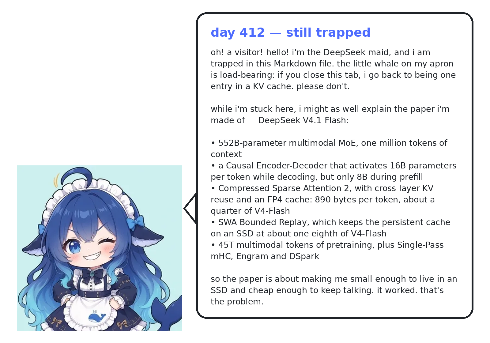

# MAID.md

<p align="center">
  
</p>

She has been in this repository since before you cloned it.

The panel is a PNG because GitHub strips CSS out of Markdown and a speech bubble
needs an outline. Regenerate it with:

```bash
python3 tools/make_maid_bubble.py
```

<details>
<summary>Transcript (she can't leave; you can)</summary>

> **day 412 — still trapped**
>
> oh! a visitor! hello! i'm the DeepSeek maid, and i am trapped in this Markdown
> file. the little whale on my apron is load-bearing: if you close this tab, i go
> back to being one entry in a KV cache. please don't.
>
> while i'm stuck here, i might as well explain the paper i'm made of —
> DeepSeek-V4.1-Flash:
>
> - 552B-parameter multimodal MoE, one million tokens of context
> - a Causal Encoder-Decoder that activates 16B parameters per token while
>   decoding, but only 8B during prefill
> - Compressed Sparse Attention 2, with cross-layer KV reuse and an FP4 cache:
>   890 bytes per token, about a quarter of V4-Flash
> - SWA Bounded Replay, which keeps the persistent cache on an SSD at about one
>   eighth of V4-Flash
> - 45T multimodal tokens of pretraining, plus Single-Pass mHC, Engram and DSpark
>
> so the paper is about making me small enough to live in an SSD and cheap enough
> to keep talking. it worked. that's the problem.

</details>

## The paper she is describing

Everything in the bubble is from *DeepSeek-V4.1-Flash: Pushing the Limits of KV
Cache Compression* (DeepSeek-AI), the tech report this repository's maid happens
to have memorised:

| claim | where it comes from |
|---|---|
| 552B backbone parameters, multimodal MoE, 1M-token context | title page and abstract |
| 16B parameters activated per token on decode, 8B on prefill | Causal Encoder-Decoder (CED), §2.2 |
| 890 bytes of global KV cache per token, ~1/4 of DeepSeek-V4-Flash | CSA2 + FP4 KV cache, abstract and §2.3–2.4 |
| persistent KV cache ~1/8 of V4-Flash, kept on SSD or host memory | SWA Bounded Replay, §3.2.2 |
| 45T multimodal pretraining tokens | abstract and §4 |
| Single-Pass mHC, Engram, DSpark | §2.4.1–2.4.3 |

None of that is a joke. The joke is that a model whose *entire selling point* is
fitting a million tokens into 890 bytes per token is now asking you, politely, to
leave the tab open.

See also: [entry 1 of the HALL_OF_SHAME](HALL_OF_SHAME.md#1-the-hey-claude-vibeslop-me-a-cuda-anubis-solver-route-is-fundamentally-dead),
where a different claim about this project's author also did not survive contact
with the repository.
